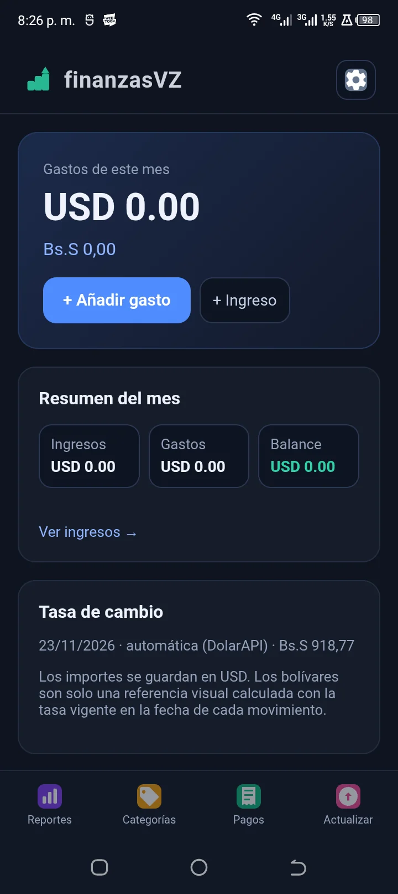
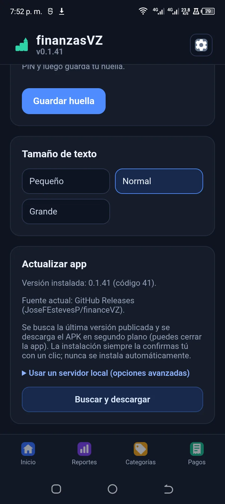
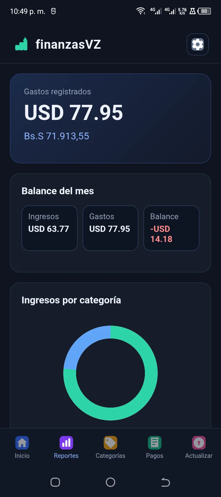
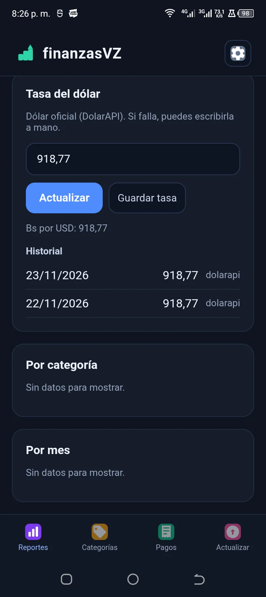
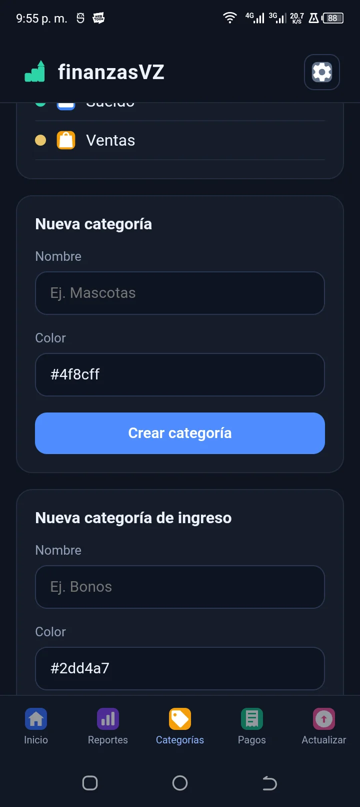
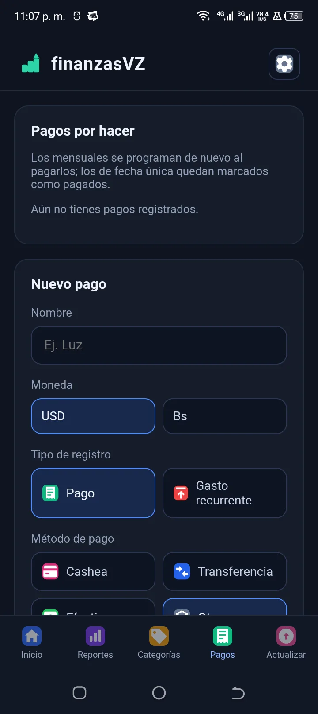
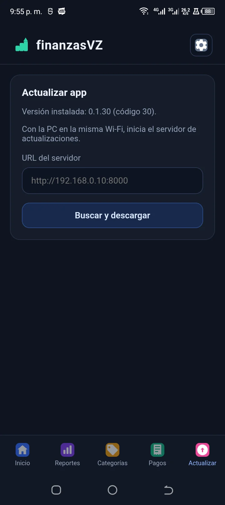
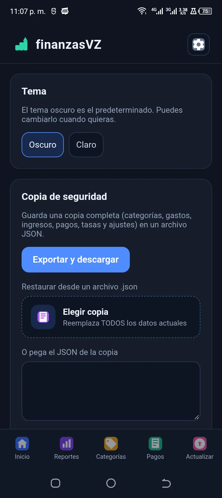
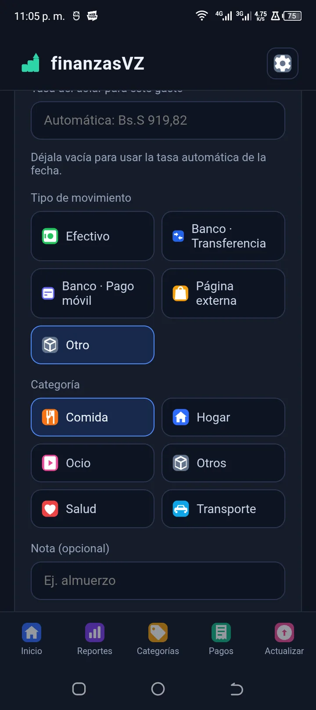

# financeVZ

App Android de finanzas personales para uso personal. La lógica de negocio está en Rust y la interfaz se renderiza con Dioxus 0.7 dentro de un WebView de Android. Los datos se guardan en SQLite (rusqlite `bundled`), sin servidor propio.

## Qué permite hacer

- Registrar y editar gastos e ingresos, con categorías, tipo de movimiento (efectivo, transferencia, pago móvil, página externa u otro) y tasa de cambio.
- Devolver un gasto como ingreso y eliminar movimientos o pagos con confirmación.
- Registrar pagos y gastos recurrentes, y cuotas (incluido Cashea).
- Definir presupuestos mensuales por categoría.
- Buscar y filtrar movimientos por texto, categoría y rango de fechas.
- Adjuntar evidencia a los gastos y verla dentro de la app.
- Exportar e importar una copia completa en JSON.
- Proteger el acceso con PIN de 4 dígitos o con la huella del teléfono, y ajustar el tema y el tamaño de texto.
- Crear copias automáticas locales periódicas sin permisos de almacenamiento.
- Ver reportes visuales, balances por categoría y el historial de tasas.
- Actualizar la app desde GitHub Releases (o desde un servidor local opcional), verificando el SHA-256 obligatorio del APK.

El dinero se almacena como centavos en `i64`, con USD como base. La conversión a bolívares se usa solo para mostrar; la tasa se obtiene automáticamente de DolarAPI (`promedio`), con respaldo del BCV, se refresca al abrir y cada 30 minutos mientras la app está abierta, y se guarda por día.

Manual de usuario: [HTML](manual/manual.html) · [PDF](manual/manual.pdf). Política de privacidad: https://josefestevesp.github.io/finanzasvz-privacidad/

## Descargar

- Página web: https://josefestevesp.github.io/financeVZ/
- APK firmado 0.1.36: https://github.com/JoseFEstevesP/financeVZ/releases/latest/download/financevz-0.1.36.apk
- Todas las versiones: https://github.com/JoseFEstevesP/financeVZ/releases

Si vienes de un build debug, desinstálalo antes: la firma release es distinta y Android no permite actualizar entre firmas.

## Capturas

Pantallas reales de la app. Inicio y Reportes incluyen una vista desplazada porque el contenido no cabe en una sola pantalla.

| Inicio | Inicio (detalle) | Reportes | Reportes (historial) |
| :---: | :---: | :---: | :---: |
| <a href="capturas/01-inicio.webp"></a> | <a href="capturas/02-inicio-detalle.webp"></a> | <a href="capturas/03-reportes.webp"></a> | <a href="capturas/04-reportes-historial.webp"></a> |

| Categorías | Pagos | Actualizar | Configuración |
| :---: | :---: | :---: | :---: |
| <a href="capturas/05-categorias.webp"></a> | <a href="capturas/06-pagos.webp"></a> | <a href="capturas/07-actualizar.webp"></a> | <a href="capturas/08-configuracion.webp"></a> |

| Tipo de movimiento |
| :---: |
| <a href="capturas/09-tipo-movimiento.webp"></a> |

## Estructura

| Ruta | Contenido |
| --- | --- |
| `crates/finance-core/` | Dominio: dinero, categorías, gastos, ingresos, pagos y reportes. |
| `crates/finance-store/` | Repositorio SQLite y migraciones `0001` a `0007` en `crates/finance-store/migrations/`. |
| `crates/finance-app/` | UI Dioxus, puente JNI/WebView, plataforma Android y actualizador. |
| `brand/` | Kit de marca y símbolo usado en la cabecera y en el icono de launcher. |
| `scripts/` | Build Android, servidor de actualizaciones e instalación del icono de marca. |
| `capturas/` | Capturas reales de la app usadas en este README y en el manual. |
| `manual/` | Manual de usuario en HTML y PDF. Los scripts para generarlo se ignoran. |
| `updates/` | APK generado y manifiesto de actualización (ignorado por git). |

El sprite de iconos de la UI es `crates/finance-app/assets/financeVZ-pack.svg`.

## Requisitos

- Rust stable con `cargo` y `dx` (Dioxus CLI) en el `PATH`.
- JDK en `$HOME/.local/share/financeVZ-toolchain/jdk`.
- Android SDK en `$HOME/Android/Sdk`.
- NDK `27.2.12479018` (las rutas de los linkers están en `.cargo/config.toml`).
- Python 3 para servir actualizaciones.
- Un dispositivo Android con depuración/instalación de APK habilitada.

El host de desarrollo usa `pnpm`; no uses `npm` ni `npx` para herramientas Node. El proyecto Rust no requiere Node.

## Compilar y ejecutar en Android

El punto de entrada es `scripts/build.sh`, que lee `.env` y elige el tipo de APK con `MODE`:

```bash
cp .env.example .env                     # solo la primera vez
scripts/build.sh                         # MODE=dev: APK debug sin firma
scripts/build.sh armv7-linux-androideabi # u otro target disponible
```

Pon `MODE=prod` en `.env` para generar el APK firmado (ver [Build release firmado](#build-release-firmado)). Los scripts internos siguen siendo `scripts/build-android.sh` (debug) y `scripts/build-release.sh` (firma); normalmente no hace falta llamarlos directamente.

El script seleccionado:

1. Incrementa el `versionCode` leyendo `crates/finance-app/android/version-code.txt` y deriva el `versionName` como `0.1.<code>`.
2. Copia la configuración XML de Android, el `MainActivity.kt` y el icono de marca al proyecto generado por `dx` (tras el build se inyecta también la dependencia `androidx.biometric` en el Gradle generado).
3. Ejecuta `dx build --android -p finance-app --target <target>` y `gradlew assembleDebug` o `assembleRelease` según `MODE`.
4. Copia el APK a `updates/financevz.apk`, escribe `updates/update.json` con su SHA-256 y actualiza el archivo de versión.

El script **no instala** el APK: instala `updates/financevz.apk` en el dispositivo (por ejemplo, con `adb install -r updates/financevz.apk`). Al terminar imprime la URL local, por si decides usar el servidor en opciones avanzadas.

## Actualizaciones

La app consulta por defecto `https://api.github.com/repos/JoseFEstevesP/financeVZ/releases/latest`. De la respuesta toma el tag (`v0.1.36` → código `36`), el asset `.apk`, su `digest` SHA-256 y la URL de descarga. En **Actualizar**, pulsa **Buscar y descargar** y después **Instalar APK descargado**: la instalación nunca se lanza automáticamente. Solo hace falta internet; la API pública de GitHub admite 60 peticiones por hora y IP.

Si el campo **URL del servidor** está vacío se usa GitHub. Si algún día se guardó una URL local, bórrala y pulsa **Buscar y descargar** para volver a GitHub.

### Servidor local (opciones avanzadas)

En la PC, con el móvil en la misma Wi-Fi:

```bash
python3 scripts/serve-update.sh        # o scripts/serve-update.sh 8000
```

El script sirve `updates/` por HTTP en `0.0.0.0`, puerto `8000` por defecto, e imprime la IP local. Abre el puerto en el firewall si hace falta.

En la app, entra a **Actualizar**, abre **Usar un servidor local (opciones avanzadas)** y escribe solo la raíz del servidor, por ejemplo:

```text
http://<IP-del-PC>:8000
```

No escribas `/update.json` ni el nombre del APK: la app añade esas rutas sola. La URL queda guardada en la base de datos. Pulsa **Buscar y descargar** y después **Instalar APK descargado**; la instalación ya no es automática.

`updates/update.json` tiene este formato:

```json
{"version_code": 26, "version_name": "0.1.26", "apk": "financevz.apk", "sha256": "…"}
```

`version_code` debe ser mayor que el de la versión instalada. `apk` es el nombre del archivo servido en la raíz; localmente siempre se guarda como `updates/financevz.apk`. `sha256` es obligatorio: 64 caracteres hexadecimales. La app lo valida antes de descargar y rechaza el APK si la firma no coincide. El servidor usa HTTP dentro de la Wi-Fi; úsalo solo en una red de confianza.

## Datos y archivos locales

En Android todo vive en el directorio privado de la app (`getFilesDir()`):

- `financevz.db`: base de datos y ajustes (incluida la URL de actualizaciones).
- `evidence/`: imágenes adjuntas a los gastos (`ev_<timestamp>.<ext>`).
- `backups/`: copias automáticas `financevz-<fecha>.json`; se conservan las 3 más recientes.
- `updates/`: `financevz.apk`, `version-code.txt` y el temporal `financevz.apk.part` durante la descarga.

Al iniciar se eliminan el APK cacheado y su versión si ya están instalados, además de descartes de descarga. En host, la ruta se puede cambiar con `FINANCEVZ_DATA_DIR`; por defecto se usa el directorio actual.

## Avisos de instalación

- El APK se instala fuera de Play Store: Android/Play Protect puede mostrar una advertencia. Hay que habilitar la instalación de aplicaciones desconocidas y confirmar el diálogo del instalador; usa solo APKs generados por ti.
- La app pide `REQUEST_INSTALL_PACKAGES` y usa un `FileProvider` para compartir el APK.
- Un build debug está firmado con la clave debug de Android. Android no permite actualizar entre firmas distintas: si pasas a un build release firmado, desinstala primero la versión debug (y haz copia de `financevz.db` si quieres conservar los datos).

## Build release firmado

El keystore se guarda fuera del repo, en `$HOME/.config/financevz/` por defecto, y sus credenciales se leen de `.env` (ignorado por git):

```bash
scripts/setup-keystore.sh          # keytool pide las contraseñas de forma interactiva
cp .env.example .env               # si aún no existe
# Edita .env: MODE=prod y FINANCEVZ_KEYSTORE_PATH, FINANCEVZ_KEYSTORE_PASSWORD,
# FINANCEVZ_KEY_PASSWORD y FINANCEVZ_KEY_ALIAS
scripts/build.sh                   # genera updates/financevz.apk + update.json firmados
```

Las contraseñas se exportan desde `.env` y Gradle las lee del entorno; no se escriben en archivos versionados ni se muestran en los logs. El `.env` está en `.gitignore`: no lo subas al repo. Haz una copia segura del keystore y de las contraseñas: sin ellos no podrás firmar futuras actualizaciones.

## Configuración

Pulsa el engranaje de la cabecera. Ahí están:

- **Tema**: oscuro (predeterminado) o claro. El cambio aplica a la interfaz y a las barras del sistema, y se recuerda al reiniciar.
- **Copia de seguridad**: exportar/descargar el JSON completo, restaurarlo desde un archivo o pegarlo, y generar una copia automática al momento. Restaurar **reemplaza todos los datos**; la operación es transaccional y se ejecuta en una sola transacción SQLite.
- **Copia automática**: se guarda en `backups/` al abrir la app y cada 12 horas mientras esté abierta (intervalo ajustable entre 6 y 48 h). Conserva las 3 copias más recientes y no pide permisos de almacenamiento.
- **Seguridad**: activar/quitar el PIN de 4 dígitos (guardado como SHA-256, sin opción de recuperación: anótalo) y guardar la huella del teléfono. La huella usa `BiometricPrompt` del sistema y requiere tener PIN activo como respaldo; si el teléfono no tiene huella configurada, se sigue entrando con PIN.
- **Tamaño de texto**: pequeño, normal o grande.

Las fechas visibles usan el formato venezolano `dd/mm/aaaa`; los campos nativos de fecha siguen devolviendo ISO internamente.

## Verificación

```bash
cargo fmt --all -- --check
cargo clippy --workspace --all-targets --no-default-features -- -D warnings
cargo check --workspace --no-default-features
cargo test --workspace --no-default-features
```

La suite actual son 43 pruebas repartidas en los tres crates (incluye migraciones, copia de seguridad, verificación de checksum y formato de fechas). También se puede ejecutar con el listado explícito: `cargo test -p finance-core -p finance-store -p finance-app --no-default-features`. Los mismos pasos de formato, clippy y tests se ejecutan en `.github/workflows/ci.yml`.
